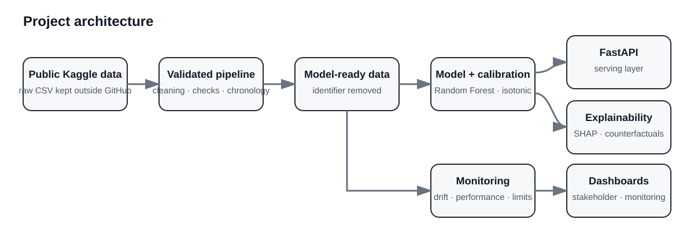
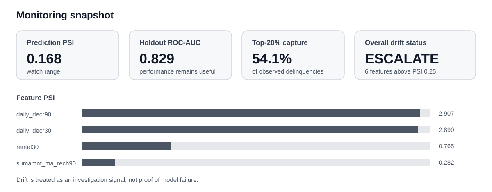
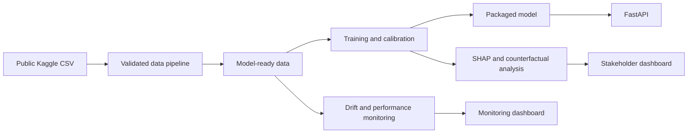

# Explainable telecom credit risk

[](https://github.com/Oyd72/explainable-telecom-credit-risk/actions/workflows/ci.yml)

A standalone machine-learning project for short-horizon repayment-risk modelling on public telecom microcredit data, with temporal validation, probability calibration, explainability, drift monitoring and lifecycle governance.

## What the project does

The model estimates the probability that a telecom-enabled microcredit transaction will remain unpaid after five days. Its intended role is to help prioritise cases for follow-up.

It does **not** approve or refuse credit automatically.

The project is built around a broader question than model accuracy alone: **can a model remain useful while its data distribution is changing, and how should that be governed?**

## Architecture at a glance



## Why this project is interesting

The source data contain a useful real-world complication. After **23 July 2016**, all 58,825 remaining records are labelled as successful repayment, with no explanation in the source documentation. Those later labels are therefore not treated as ordinary supervised ground truth.

That leads to a deliberately conservative design:

- chronology is preserved throughout modelling and validation;
- the final holdout remains outside fitting, calibration and threshold selection;
- drift is monitored separately from predictive performance;
- protected demographic attributes are not inferred when the data do not contain them;
- SHAP and counterfactual-style outputs are treated as model explanations, not causal evidence;
- retraining creates a candidate only and never promotes a model automatically.

## Key results

The reference model is a **12-feature Random Forest** with median imputation and isotonic probability calibration.

| Metric | Final holdout |
|---|---:|
| ROC-AUC | **0.8288** |
| Average precision | **0.5673** |
| Top-20% delinquency capture | **54.06%** |
| Precision at threshold 0.1751 | **42.61%** |
| Recall at threshold 0.1751 | **77.47%** |
| Brier score | **0.1230** |
| Expected calibration error | **0.0293** |

The evaluation uses **28,648 chronologically later records** from 14–23 July 2016.

A useful monitoring result appears alongside these metrics: the model continues to discriminate well on the later holdout even though several input distributions have moved materially.

| Monitoring indicator | Result |
|---|---:|
| Prediction-score PSI | **0.168** — watch |
| Prediction-score KS | **0.076** |
| Features at escalation level | **6** |
| Overall drift status | **Escalate** |

This is the central operational lesson of the project: **drift is a reason to investigate, not proof that a model has already failed**.



## Modelling approach

Model development compares:

- logistic regression as an interpretable baseline;
- Random Forest for nonlinear relationships and interactions;
- XGBoost as a second nonlinear challenger.

Evaluation uses expanding chronological folds instead of random train/test mixing.

The reference model is:

- trained through **6 July 2016**;
- calibrated on **7–13 July 2016**;
- evaluated on **14–23 July 2016**.

The operating threshold of **0.1751** is fixed before the final holdout is evaluated.

Configuration is kept in [`config/model.yaml`](config/model.yaml), and the full model card is in [`docs/model_card.md`](docs/model_card.md).

## Explainability

The project uses global and local SHAP analysis plus constrained counterfactual-style examples.

The strongest global signals are dominated by recharge behaviour, especially 90-day recharge count and amount, shorter-window recharge activity and daily decrement measures.

SHAP is applied to the fitted Random Forest before isotonic calibration. Calibration changes the probability scale; it does not change the tree structure being explained.

Counterfactual-style analysis asks whether small changes, restricted to values observed in the training distribution, would move a score across the operating threshold. These examples describe model sensitivity and are **not** recommendations for customer behaviour.

See [`docs/explainability.md`](docs/explainability.md).

## Monitoring

Monitoring separates two questions:

1. Has the input or prediction distribution changed?
2. Has predictive performance changed?

The first can be checked without labels. The second requires trustworthy matured outcomes.

The implementation monitors:

- Population Stability Index;
- KS statistics;
- missingness changes;
- prediction-score movement;
- ROC-AUC and average precision when labels are reliable;
- calibration, precision, recall, F1 and top-20% capture.

An optional Evidently implementation provides an independent drift cross-check.

See [`docs/monitoring.md`](docs/monitoring.md).

## Governance and evidence limits

The repository includes governance controls because technical performance alone does not determine whether a model is suitable for use.

The governance layer covers:

- intended use and human oversight;
- fairness evidence limits;
- algorithmic impact assessment;
- incident response;
- governed retraining;
- model retirement.

The source data contain no reliable protected demographic attributes. The project therefore does **not** claim demographic fairness and does not manufacture proxy groups to produce fairness metrics.

Key documents are under [`docs/governance/`](docs/governance/).

## Architecture



The serving and dashboard layers are separated so they can be run and controlled independently.

More detail is available in [`docs/architecture.md`](docs/architecture.md).

## Repository map

| Path | Purpose |
|---|---|
| `src/data/` | Cleaning, validation and privacy-safe audit logic |
| `src/features/` | Model-ready dataset construction |
| `src/modeling/` | Benchmarking, training, calibration and retraining |
| `src/explainability/` | SHAP and counterfactual-style analysis |
| `src/monitoring/` | Drift, performance and representation monitoring |
| `src/inference/` | Batch inference |
| `src/api/` | FastAPI model service |
| `dashboards/` | Stakeholder and monitoring Streamlit applications |
| `config/` | Model, monitoring and retraining configuration |
| `docs/` | Architecture, methodology, model card and governance |
| `reports/` | Aggregate reproducibility evidence and figures |
| `.github/workflows/` | Continuous integration |

## Reproduce the project

### 1. Clone and create an environment

```bash
git clone https://github.com/Oyd72/explainable-telecom-credit-risk.git
cd explainable-telecom-credit-risk

python -m venv .venv
```

Activate the environment for your operating system, then install the dependencies:

```bash
python -m pip install --upgrade pip
pip install -r requirements.txt
pip install -r requirements-serving.txt
```

### 2. Obtain the source data

Download the public [Delinquency Telecom Dataset](https://www.kaggle.com/datasets/sivakrishna3311/delinquency-telecom-dataset) from Kaggle.

Place the CSV at:

```text
data/raw/sample_data_intw.csv
```

Raw customer-level data are intentionally not stored in this repository.

### 3. Run the validated data pipeline

```bash
python -m src.pipeline.flow
```

The pipeline performs raw diagnostics, cleaning, blocking interim and processed validation, chronology-aware feature construction, identifier minimisation and representation diagnostics.

### 4. Compare models and train the reference model

```bash
python -m src.modeling.benchmark
python -m src.modeling.train
```

The training command generates the local model artefact and evaluation evidence.

### 5. Generate explanations

```bash
python -m src.explainability.shap_analysis
python -m src.explainability.counterfactual
```

### 6. Run monitoring

```bash
python -m src.monitoring.prepare
python -m src.monitoring.run
```

Optional Evidently cross-check:

```bash
python -m src.monitoring.evidently_check
```

## Run the API and dashboards

Start the API directly:

```bash
uvicorn src.api.app:app --reload
```

Or run all three local services with Docker Compose:

```bash
docker compose up --build
```

Local endpoints:

| Service | Address |
|---|---|
| FastAPI service | `http://localhost:8000` |
| Interactive API docs | `http://localhost:8000/docs` |
| Stakeholder dashboard | `http://localhost:8501` |
| Monitoring dashboard | `http://localhost:8502` |

The model binary is generated locally and is not committed by default.

## Technology

Python, pandas, scikit-learn, XGBoost, SHAP, Great Expectations, Prefect, Evidently, FastAPI, Streamlit, Docker and GitHub Actions.

## Important limitations

This repository demonstrates a reproducible modelling and governance workflow on historical public data. It is not evidence that the model is suitable for unrestricted production lending use.

Fresh representative validation would be required before deployment on a different population. The available observation period is short, causal effects cannot be inferred from the model explanations, and demographic fairness cannot be established from the available attributes.

## Project origin

This repository is a standalone rebuild of an earlier analytics prototype. The code structure, documentation, reproducibility workflow and lifecycle controls have been reorganised around the project itself rather than an external delivery framework.
