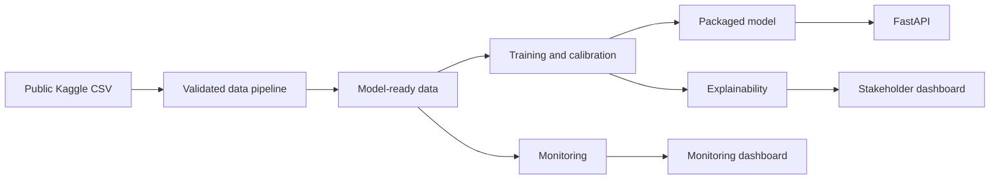

# System architecture

The project separates modelling, model serving, stakeholder communication and monitoring.

## Serving

The FastAPI service returns raw and calibrated five-day delinquency probabilities plus a threshold-based higher-risk flag. The flag is for prioritisation only; it is not an approval or refusal decision.

## Dashboards

The stakeholder dashboard presents performance, SHAP importance, counterfactual-style examples and known limits. The monitoring dashboard presents feature drift, prediction-score drift and later-period performance.

## Containers

`docker-compose.yml` defines the API, stakeholder dashboard and monitoring dashboard as separate services. Build the model locally with `python -m src.modeling.train` before building the API container.

## CI

The GitHub Actions workflow compiles the main entry points, validates Docker Compose and starts both dashboards in headless mode as smoke tests.
